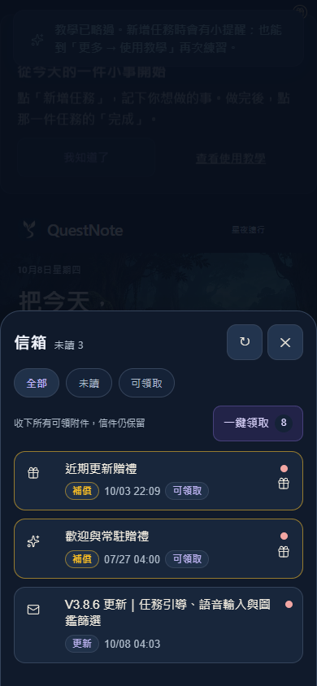

# 信箱統整驗證 — 2026-10-08

來源基準：`45e1c29`（最新主線的 V3.8.6 公告已包含在內）。實作分支：`codex/mailbox-consolidation`；新版 runtime 來源：V3.8.7。尚未整合 main、push 或部署。

全部清單由 11 封有效信件整理成 3 個入口：歡迎與常駐贈禮、近期更新贈禮、原 V3.8.6 公告。僅停用兩封過時的無獎勵公告；沒有新增補償。贈禮入口內顯示每份附件的數量、原期限、領取狀態，可單份領取及查看原信。

既有 9 封 compensation（含早已過期的一封）與 V3.8.6 公告的完整內容，以基準 SHA256 驗證保持不變。當日有效贈禮共 8 份：5,300 星塵、23 冒險能量、50 相遇碎片、5 小份靈食。部分已領、到期、舊 App 版本與全領後重試皆有檢查；資料交易、claimedIds、備份格式未變，群組 ID 不會寫入 claimedIds。

## 實測

- `npm test` 成功：344 + 14 + 12 個測試均通過，另含 12 個 product-flow focused checks 與 reveal-flow checks。
- 新增的信箱測試 5 項全數通過，已納入 `npm test`；既有 mailbox fragments 與 reward claim targeted tests 也通過。
- 修改的 JS 通過 `node --check`，`git diff --check` 通過。
- Edge 隔離 context 實測 320×568、390×844、1280×900：全部清單 3 個入口、更新贈禮 6 份附件、最末領取按鈕可捲動抵達。單份領取後再一鍵領取，只發剩餘獎勵；重新載入後仍為 3 個入口、沒有可重領附件、沒有 pageerror。
- 實際檢視手機截圖，標題、未讀數、篩選與一鍵領取可見，窄畫面附件按鈕可達。

初次驗證的環境失敗已處理：沙箱限制 Git fixture／OneDrive realpath／Edge 啟動，改用本機批准執行；依賴安裝使用系統受信任憑證（未停用 TLS 驗證）。全量重跑已成功。完整日誌與更多截圖保存在此工作副本 `.dev-backups/mailbox-check/`。

## 工作副本保留

官方 Git 短路徑工作副本 `.worktrees/mc` 由本 chat 建立。治理 wrapper 因 OneDrive ReparsePoint metadata 拒絕執行，App 建立則遭 Windows 長檔名阻擋；未刪除既有工作副本。生命周期記錄於 `.dev-backups/mailbox-check/lifecycle.json`，結束標記 Hold，原因為未 push 的本機成果與驗收資料需保留供後續整合。依賴以鎖檔 npm ci 安裝，無複製其他環境依賴。
